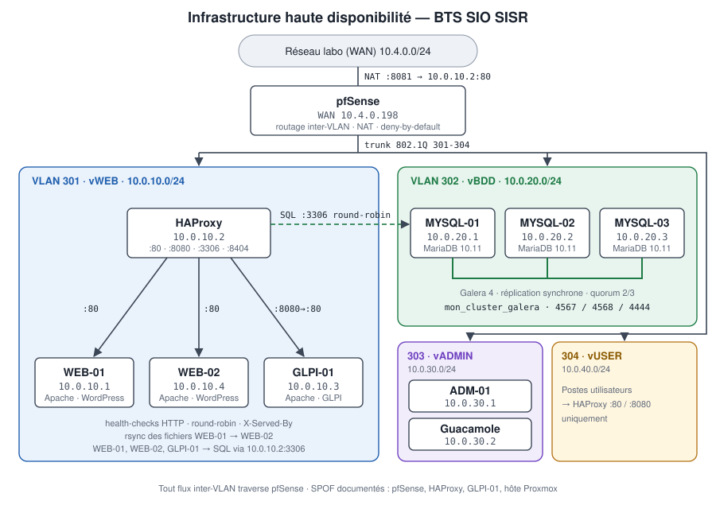

<div align="center">

# BTS SIO HA Infrastructure

**Infrastructure web et base de données haute disponibilité — BTS SIO option SISR**

pfSense · VLAN · HAProxy · MariaDB Galera (3 nœuds) · WordPress redondé · GLPI

[](docs/README.md)
[](https://www.debian.org/)
[](https://mariadb.com/kb/en/galera-cluster/)
[](https://www.haproxy.org/)
[](https://wordpress.org/)
[](https://www.pfsense.org/)
[](docs/11-bts-sio/skills.md)
[](LICENSE)

</div>

> **En 30 secondes** — Ce dépôt documente et permet de reproduire un lab de haute disponibilité :
> un site WordPress servi par **deux serveurs web** derrière **HAProxy**, adossé à un **cluster MariaDB Galera de 3 nœuds**,
> avec **GLPI**, le tout segmenté en **VLAN** et filtré par **pfSense**.
>
> Documentation : [`docs/`](docs/README.md) · Configurations : [`configs/`](configs/README.md) · Tests : [`scripts/`](scripts/README.md) · Reproduction : [ordre de déploiement](docs/00-overview/deployment-order.md)

---

## Table des matières

1. [Résumé](#résumé)
2. [Objectif du projet](#objectif-du-projet)
3. [Architecture](#architecture)
4. [Schéma principal](#schéma-principal)
5. [Technologies](#technologies)
6. [Plan d'adressage](#plan-dadressage)
7. [Fonctionnement haute disponibilité](#fonctionnement-haute-disponibilité)
8. [Fonctionnement Galera](#fonctionnement-galera)
9. [Fonctionnement HAProxy](#fonctionnement-haproxy)
10. [WordPress redondé](#wordpress-redondé)
11. [GLPI](#glpi)
12. [Sécurité](#sécurité)
13. [Installation rapide](#installation-rapide)
14. [Documentation complète](#documentation-complète)
15. [Documentation interactive](#documentation-interactive)
16. [Tests](#tests)
17. [Failover validé](#failover-validé)
18. [Limites](#limites)
19. [Roadmap](#roadmap)
20. [BTS SIO](#bts-sio)
21. [Fiche portfolio](#fiche-portfolio)
22. [Captures](#captures)
23. [Structure du dépôt](#structure-du-dépôt)
24. [Contribuer](#contribuer)
25. [Licence](#licence)

---

## Résumé

| Élément | Description |
|---------|-------------|
| **Contexte** | Projet d'infrastructure réalisé en BTS SIO option SISR, sur un hyperviseur Proxmox VE |
| **Problème** | Un site hébergé sur un seul serveur et une seule base de données s'arrête dès qu'une machine tombe |
| **Solution** | Redonder la couche web (2 WordPress) et la couche données (Galera 3 nœuds), répartir la charge avec HAProxy, isoler les flux par VLAN |
| **Résultat** | L'arrêt d'un serveur web ou d'un nœud de base de données n'interrompt pas le service |
| **Statut** | Version 1.0.0 — lab fonctionnel, SPOF restants identifiés et documentés |

## Objectif du projet

- Concevoir une architecture **sans point unique de défaillance sur les couches web et données**.
- Mettre en œuvre une **réplication synchrone multi-maître** (MariaDB Galera).
- Mettre en œuvre la **répartition de charge** HTTP (couche 7) et SQL (couche 4) avec HAProxy.
- **Segmenter le réseau** (VLAN) et appliquer une politique de filtrage **deny-by-default**.
- **Prouver** la tolérance aux pannes par des tests reproductibles et documentés.
- Produire une documentation permettant à un tiers de **reconstruire le lab**.

Détails : [docs/00-overview/objectives.md](docs/00-overview/objectives.md)

## Architecture

L'infrastructure est découpée en quatre VLAN routés et filtrés par pfSense :

| VLAN | Nom | Réseau | Passerelle | Contenu |
|------|-----|--------|------------|---------|
| 301 | vWEB | 10.0.10.0/24 | 10.0.10.254 | HAProxy, WEB-01, WEB-02, GLPI-01 |
| 302 | vBDD | 10.0.20.0/24 | 10.0.20.254 | MYSQL-01, MYSQL-02, MYSQL-03 |
| 303 | vADMIN | 10.0.30.0/24 | 10.0.30.254 | ADM-01, Guacamole |
| 304 | vUSER | 10.0.40.0/24 | 10.0.40.254 | Postes utilisateurs |

WAN pfSense : `10.4.0.198/24`, passerelle `10.4.0.254` (réseau du laboratoire, non routé sur Internet).

Détails : [architecture-overview.md](docs/01-architecture/architecture-overview.md) · [vlan-design.md](docs/01-architecture/vlan-design.md) · [network-flows.md](docs/01-architecture/network-flows.md)

## Schéma principal

<p align="center">
  
</p>

Version texte :

```text
                 Réseau labo (WAN 10.4.0.0/24)
                            │
                    ┌───────┴────────┐
                    │    pfSense     │   NAT WAN:8081 → 10.0.10.2:80
                    └───┬────────┬───┘
          VLAN 301 vWEB │        │ VLAN 302 vBDD
                        │        │
                 ┌──────┴─────┐  │
                 │  HAProxy   │  │
                 │ 10.0.10.2  ├──┼──── :3306 TCP round-robin ─────┐
                 └──┬──────┬──┘  │                                │
              :80   │      │ :80 │                   ┌────────────┼────────────┐
             ┌──────┴─┐  ┌─┴──────┐                  │            │            │
             │ WEB-01 │  │ WEB-02 │              MYSQL-01     MYSQL-02     MYSQL-03
             │10.0.10.1│ │10.0.10.4│             10.0.20.1    10.0.20.2    10.0.20.3
             └────────┘  └────────┘                  └──── réplication Galera ──┘

             GLPI-01 10.0.10.3  ←  HAProxy :8080
```

Autres schémas : [diagrams/](diagrams/README.md)

## Technologies

| Domaine | Technologie | Version | Rôle |
|---------|-------------|---------|------|
| Virtualisation | Proxmox VE | 8.x | Hébergement des VM |
| Pare-feu / routage | pfSense CE | 2.7.x | Routage inter-VLAN, NAT, filtrage |
| Système | Debian | 12 (Bookworm) | Toutes les VM Linux |
| Répartition de charge | HAProxy | 2.6 (paquet Debian) | HTTP couche 7 + SQL couche 4 |
| Base de données | MariaDB + Galera | 10.11 + Galera 4 | Cluster synchrone multi-maître |
| Web | Apache 2.4 + PHP 8.2 | paquets Debian | Serveurs WordPress et GLPI |
| CMS | WordPress | 6.x | Application redondée |
| ITSM | GLPI | 10.x | Gestion de parc et tickets |
| Accès distant | Apache Guacamole | — | Bastion d'administration web |

## Plan d'adressage

| VM | IP | VLAN | Rôle |
|----|----|------|------|
| WEB-01 | 10.0.10.1 | 301 | WordPress |
| HAProxy | 10.0.10.2 | 301 | Load-balancer |
| GLPI-01 | 10.0.10.3 | 301 | GLPI |
| WEB-02 | 10.0.10.4 | 301 | WordPress |
| MYSQL-01 | 10.0.20.1 | 302 | Galera |
| MYSQL-02 | 10.0.20.2 | 302 | Galera |
| MYSQL-03 | 10.0.20.3 | 302 | Galera |
| ADM-01 | 10.0.30.1 | 303 | Administration |
| Guacamole | 10.0.30.2 | 303 | Accès distant |

Plan complet (ports, passerelles, services) : [docs/01-architecture/ip-addressing.md](docs/01-architecture/ip-addressing.md)

## Fonctionnement haute disponibilité

| Couche | Redondance | Mécanisme | Tolérance |
|--------|------------|-----------|-----------|
| Web | WEB-01 + WEB-02 | HAProxy `balance roundrobin` + health-check HTTP | 1 serveur web sur 2 |
| Données | MYSQL-01/02/03 | Galera, réplication synchrone, quorum | 1 nœud sur 3 |
| Accès SQL | HAProxy :3306 | Health-check `mysql-check`, retrait automatique | Nœud indisponible écarté |
| Répartiteur | HAProxy seul | — | **SPOF** (voir [roadmap](#roadmap)) |
| Pare-feu | pfSense seul | — | **SPOF** |

La haute disponibilité **n'est pas une sauvegarde** : une suppression accidentelle est répliquée instantanément sur les trois nœuds. Voir [docs/10-backup-recovery/strategy.md](docs/10-backup-recovery/strategy.md).

Analyse complète : [docs/01-architecture/spof-analysis.md](docs/01-architecture/spof-analysis.md)

## Fonctionnement Galera

- **Multi-maître synchrone** : chaque nœud accepte lectures et écritures ; une transaction n'est validée qu'après certification par le cluster.
- **Quorum** : le cluster reste `Primary` tant qu'une majorité stricte de nœuds se voit (2 sur 3). Avec 3 nœuds, on tolère la perte d'un nœud.
- **Ports** : `3306` (SQL), `4567` (réplication), `4568` (IST), `4444` (SST).
- **SST** par `rsync` (transfert complet d'état) à l'arrivée d'un nœud.

```ini
# configs/galera/mysql01/60-galera.cnf.example (extrait)
wsrep_on                 = ON
wsrep_provider           = /usr/lib/galera/libgalera_smm.so
wsrep_cluster_name       = "mon_cluster_galera"
wsrep_cluster_address    = "gcomm://10.0.20.1,10.0.20.2,10.0.20.3"
wsrep_node_address       = "10.0.20.1"
wsrep_node_name          = "MYSQL-01"
wsrep_sst_method         = rsync
binlog_format            = ROW
default_storage_engine   = InnoDB
innodb_autoinc_lock_mode = 2
```

Documentation : [docs/03-galera/](docs/03-galera/concepts.md) · Reprise après panne : [recovery.md](docs/03-galera/recovery.md)

## Fonctionnement HAProxy

| Frontend | Écoute | Mode | Serveurs |
|----------|--------|------|----------|
| `fe_wordpress` → `be_wordpress` | 10.0.10.2:80 | HTTP | 10.0.10.1:80, 10.0.10.4:80 |
| `fe_glpi` → `be_glpi` | 10.0.10.2:8080 | HTTP | 10.0.10.3:80 |
| `galera_cluster` | 10.0.10.2:3306 | TCP | 10.0.20.1, 10.0.20.2, 10.0.20.3 (:3306) |
| `stats` | 10.0.10.2:8404 | HTTP | Page de statistiques (accès vADMIN) |

Chaque serveur est surveillé (`check`) : un serveur qui ne répond plus est retiré automatiquement, puis réintégré à son retour (`rise` / `fall`).
Un en-tête `X-Served-By` indique quel backend a répondu, ce qui rend le failover **observable** avec un simple `curl -I`.

Configuration anonymisée : [configs/haproxy/haproxy.cfg.example](configs/haproxy/haproxy.cfg.example)

## WordPress redondé

- WEB-01 et WEB-02 exécutent **le même code WordPress** et le même `wp-config.php`.
- Les deux se connectent à la base via **HAProxy** (`DB_HOST = 10.0.10.2:3306`), jamais directement à un nœud.
- **Galera réplique la base, pas les fichiers** : médias (`wp-content/uploads`), thèmes et extensions sont synchronisés par `rsync` de WEB-01 vers WEB-02. C'est une limite connue (voir [synchronization.md](docs/05-wordpress/synchronization.md)).

## GLPI

GLPI-01 (10.0.10.3) est publié via HAProxy sur le port `8080` et utilise le cluster Galera via `10.0.10.2:3306`.
GLPI n'est **pas redondé** (un seul serveur applicatif) : c'est un SPOF assumé et documenté.

Documentation : [docs/06-glpi/](docs/06-glpi/installation.md)

## Sécurité

- **Segmentation** : 4 VLAN, routage inter-VLAN filtré par pfSense, politique **deny-by-default**.
- **Base de données non exposée** : le VLAN vBDD n'accepte le port 3306 que depuis HAProxy, et les ports Galera uniquement entre nœuds.
- **Administration** : SSH par clé depuis le VLAN vADMIN uniquement, pas de connexion root, bastion Guacamole.
- **Moindre privilège** : un compte SQL par application, limité à sa base et à l'IP de HAProxy.
- **Secrets** : aucun secret dans ce dépôt — fichiers `*.example` avec `<SECRET>` / `<PASSWORD>`. Voir [SECURITY.md](SECURITY.md).

Détails : [docs/07-security/](docs/07-security/network-segmentation.md)

## Installation rapide

> Prérequis : Proxmox VE, 9 VM Debian 12, pfSense. Liste complète : [requirements.md](docs/00-overview/requirements.md).
> L'ordre exact est décrit dans [deployment-order.md](docs/00-overview/deployment-order.md).

```bash
# SUR ADM-01 : récupérer le dépôt
git clone https://github.com/<GITHUB_USER>/bts-sio-ha-infrastructure.git
cd bts-sio-ha-infrastructure

# SUR MYSQL-01 (puis 02, 03) : paquets Galera — simulation par défaut, --apply pour exécuter
sudo ./scripts/install/install-galera.sh --node-name MYSQL-01 --node-ip 10.0.20.1 --apply

# SUR HAPROXY : installation, puis configuration à partir de l'exemple
sudo ./scripts/install/install-haproxy.sh --apply
sudo cp configs/haproxy/haproxy.cfg.example /etc/haproxy/haproxy.cfg   # remplacer les <PLACEHOLDER>
sudo haproxy -c -f /etc/haproxy/haproxy.cfg

# SUR ADM-01 : contrôles
./scripts/validation/check-network.sh
./scripts/validation/check-wordpress.sh
```

Le bootstrap Galera **n'est jamais automatisé** : il se fait manuellement, une seule fois, sur un seul nœud ([bootstrap.md](docs/03-galera/bootstrap.md)).

## Documentation complète

| Section | Contenu |
|---------|---------|
| [00 — Vue d'ensemble](docs/00-overview/project-context.md) | Contexte, objectifs, prérequis, ordre de déploiement, glossaire |
| [01 — Architecture](docs/01-architecture/architecture-overview.md) | Topologie, adressage, VLAN, flux, HA, SPOF |
| [02 — pfSense](docs/02-pfsense/installation.md) | Interfaces, VLAN, règles, NAT |
| [03 — Galera](docs/03-galera/concepts.md) | Concepts, installation, bootstrap, reprise |
| [04 — HAProxy](docs/04-haproxy/installation.md) | SQL, HTTP, GLPI, health-checks |
| [05 — WordPress](docs/05-wordpress/wordpress.md) | WEB-01, WEB-02, synchronisation, failover |
| [06 — GLPI](docs/06-glpi/installation.md) | Installation, Apache, base, publication |
| [07 — Sécurité](docs/07-security/network-segmentation.md) | Segmentation, SSH, secrets, durcissement |
| [08 — Tests](docs/08-tests/test-plan.md) | Plan de tests, matrice de validation |
| [09 — Dépannage](docs/09-troubleshooting/incidents.md) | Incidents réels, méthodologie |
| [10 — Sauvegarde](docs/10-backup-recovery/strategy.md) | Stratégie, MariaDB, WordPress, GLPI, Proxmox |
| [11 — BTS SIO](docs/11-bts-sio/skills.md) | Compétences, oral, questions du jury, rétrospective |
| [12 — Gestion de projet](docs/12-project-management/git-workflow.md) | Git, labels, GitHub Project, release |

Index : [docs/README.md](docs/README.md)

## Documentation interactive

Le dossier [`generator/`](generator/README.md) contient une **application HTML autonome, utilisable hors ligne**, qui génère une infrastructure équivalente avec **vos propres** IP, VLAN, noms de VM, ports et comptes : `haproxy.cfg`, configurations Galera des 3 nœuds, `wp-config.php`, vhosts Apache, `~/.ssh/config` et plan d'adressage.

Ouvrir simplement `generator/index.html` dans un navigateur : aucun serveur, aucune dépendance, aucune donnée envoyée.

Publication optionnelle avec GitHub Pages (*Settings → Pages → Deploy from a branch → `main` / `(root)`*) : le générateur est alors disponible sur `https://<GITHUB_USER>.github.io/bts-sio-ha-infrastructure/generator/`.

## Tests

| Script | Machine | Vérifie |
|--------|---------|---------|
| [check-network.sh](scripts/validation/check-network.sh) | ADM-01 | Passerelles, hôtes, ports ouverts |
| [check-galera.sh](scripts/validation/check-galera.sh) | MYSQL-0X | `cluster_size=3`, `Primary`, `Synced`, `wsrep_ready=ON` |
| [check-haproxy.sh](scripts/validation/check-haproxy.sh) | HAPROXY | Service, syntaxe, ports, état des backends |
| [check-wordpress.sh](scripts/validation/check-wordpress.sh) | ADM-01 | Code HTTP de WEB-01, WEB-02 et HAProxy |
| [check-glpi.sh](scripts/validation/check-glpi.sh) | ADM-01 | GLPI en direct et via HAProxy |
| [test-sql-round-robin.sh](scripts/utilities/test-sql-round-robin.sh) | HAPROXY / WEB-0X | Répartition de `SELECT @@hostname` |
| [check-repository.sh](scripts/validation/check-repository.sh) | Poste dev / CI | Structure du dépôt, absence de secrets |

Exemple de sortie attendue :

```text
[INFO] Checking Galera status...
[OK]   wsrep_cluster_size = 3
[OK]   wsrep_cluster_status = Primary
[OK]   wsrep_local_state_comment = Synced
[OK]   wsrep_ready = ON
```

Matrice de validation (20 tests, T01 à T20) : [docs/08-tests/validation-matrix.md](docs/08-tests/validation-matrix.md)

```bash
make check   # structure du dépôt + secrets + syntaxe shell (poste de développement)
```

## Failover validé

| Scénario | Action | Résultat attendu | Procédure |
|----------|--------|------------------|-----------|
| Panne WEB-01 | `sudo systemctl stop apache2` sur WEB-01 | WEB-02 répond seul via 10.0.10.2 | [wordpress-failover.md](docs/08-tests/wordpress-failover.md) |
| Panne WEB-02 | `sudo systemctl stop apache2` sur WEB-02 | WEB-01 répond seul | [wordpress-failover.md](docs/08-tests/wordpress-failover.md) |
| Retour d'un backend | `sudo systemctl start apache2` | Serveur réintégré automatiquement | [wordpress-failover.md](docs/08-tests/wordpress-failover.md) |
| Panne d'un nœud Galera | `sudo systemctl stop mariadb` | `cluster_size=2`, `Primary`, service maintenu | [galera-tests.md](docs/08-tests/galera-tests.md) |

```bash
# SUR ADM-01
curl -sI http://10.0.10.2 | grep -Ei 'HTTP/|X-Served-By'
```

> Les preuves (captures, sorties de commandes) sont rangées dans [`evidence/`](evidence/README.md). Le statut réel de chaque test est tenu dans la [matrice de validation](docs/08-tests/validation-matrix.md).

## Limites

Ce lab est volontairement transparent sur ce qu'il **ne couvre pas** encore :

- **HAProxy est un SPOF** : pas de second répartiteur ni d'IP virtuelle (Keepalived / VRRP).
- **pfSense est un SPOF** : pas de cluster CARP.
- **Health-check SQL non « wsrep-aware »** : `mysql-check` vérifie que MariaDB répond, pas qu'il est `Synced`.
- **Écritures en round-robin** sur Galera : risque de conflits de certification sous forte concurrence (acceptable en lab, à revoir en production).
- **Fichiers WordPress** synchronisés par `rsync`, pas par un stockage partagé.
- **HTTP uniquement** : pas de TLS.
- **Un seul hôte Proxmox** : sa panne arrête tout.
- **Pas de supervision** ni de sauvegardes automatisées.

## Roadmap

- [x] VLAN et routage inter-VLAN pfSense
- [x] Cluster Galera 3 nœuds
- [x] HAProxy SQL
- [x] WordPress WEB-01
- [x] WordPress WEB-02
- [x] Failover HTTP
- [x] GLPI
- [x] NAT vers HAProxy
- [ ] HAProxy secondaire
- [ ] Keepalived
- [ ] IP virtuelle (VIP)
- [ ] HTTPS
- [ ] Health-check Galera *wsrep-aware* (clustercheck)
- [ ] Stockage partagé WordPress (NFS / GlusterFS)
- [ ] Supervision (Prometheus + Grafana, ou Zabbix / Centreon)
- [ ] Sauvegardes automatisées
- [ ] Tests de restauration planifiés

Issues suggérées et organisation : [docs/12-project-management/github-project.md](docs/12-project-management/github-project.md)

## BTS SIO

| Document | Usage |
|----------|-------|
| [skills.md](docs/11-bts-sio/skills.md) | Compétences du référentiel mobilisées |
| [oral-presentation.md](docs/11-bts-sio/oral-presentation.md) | Trame de l'oral et démonstration |
| [jury-questions.md](docs/11-bts-sio/jury-questions.md) | Questions probables du jury et réponses |
| [project-retrospective.md](docs/11-bts-sio/project-retrospective.md) | Bilan, difficultés, apprentissages |
| [pre-publish-checklist.md](docs/11-bts-sio/pre-publish-checklist.md) | Checklists publication et soutenance |

## Fiche portfolio

> Section reprenable telle quelle dans un portfolio.

- **Projet** — Infrastructure web haute disponibilité (BTS SIO SISR).
- **Contexte** — Lab virtualisé sous Proxmox : 9 VM Debian, pfSense, 4 VLAN.
- **Objectif** — Supprimer les points uniques de défaillance des couches web et données d'un site WordPress.
- **Technologies** — pfSense, VLAN 802.1Q, HAProxy, MariaDB 10.11, Galera 4, Apache, PHP, WordPress, GLPI, SSH, Bash, Git.
- **Réalisations** — Cluster Galera 3 nœuds ; répartition de charge HTTP et SQL ; 2 serveurs WordPress ; GLPI ; filtrage deny-by-default ; scripts de validation ; procédures de failover.
- **Difficultés** — Quorum et bootstrap Galera, `bind-address`, synchronisation des fichiers WordPress, conflit avec le compte système HAProxy, réécritures Apache de GLPI.
- **Résultats** — Arrêt d'un serveur web ou d'un nœud SQL sans interruption du site ; SPOF résiduels identifiés.
- **Compétences** — Concevoir une solution d'infrastructure, installer et configurer des services, assurer la disponibilité, sécuriser, diagnostiquer, documenter.

## Captures

Aucune capture n'est fabriquée : les emplacements et la convention de nommage sont définis dans [evidence/README.md](evidence/README.md). Les captures réelles y sont ajoutées au fil des tests.

| Capture attendue | Fichier |
|------------------|---------|
| VLAN pfSense | `evidence/screenshots/01-pfsense-vlans.png` |
| Cluster Galera (taille 3) | `evidence/screenshots/03-galera-cluster-size.png` |
| Page de statistiques HAProxy | `evidence/screenshots/05-haproxy-status.png` |
| Failover WEB-01 | `evidence/screenshots/08-failover-web01-down.png` |

## Structure du dépôt

```text
.
├── docs/           Documentation (sections numérotées 00 à 12)
├── configs/        Configurations anonymisées (*.example)
├── scripts/        Installation, validation, failover, sauvegarde
├── generator/      Générateur HTML hors ligne
├── diagrams/       Schémas SVG
├── evidence/       Preuves de tests (captures réelles)
├── deliverables/   Livrables de soutenance (HTML / PDF)
├── examples/       Fiche de référence du lab
└── .github/        CI, templates d'issues et de pull requests
```

## Contribuer

Branches `feature/*`, `fix/*`, `docs/*` → `develop` → `main`, commits au format [Conventional Commits](https://www.conventionalcommits.org/fr/).
Voir [CONTRIBUTING.md](CONTRIBUTING.md), [CODE_OF_CONDUCT.md](CODE_OF_CONDUCT.md) et [SECURITY.md](SECURITY.md). Historique : [CHANGELOG.md](CHANGELOG.md).

## Licence

Distribué sous licence [MIT](LICENSE) : réutilisation libre, y compris pour d'autres projets pédagogiques, à condition de conserver la mention de licence.
