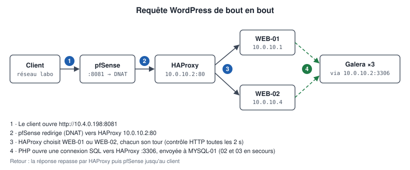
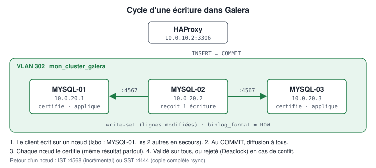

# Flux réseau

Matrice de **tous les flux légitimes**. Tout flux absent de ce tableau est interdit (deny-by-default).

## Matrice des flux

| # | Source | Destination | Proto / port | Traverse pfSense | Usage |
|---|--------|-------------|--------------|------------------|-------|
| F01 | Réseau labo (WAN) | 10.4.0.198:8081 → 10.0.10.2:80 | TCP 8081 → 80 | Oui (NAT) | Accès externe à WordPress |
| F02 | vUSER | HAProxy 10.0.10.2 | TCP 80, 8080 | Oui | WordPress et GLPI internes |
| F03 | HAProxy | WEB-01, WEB-02 | TCP 80 | Non (même VLAN) | Répartition HTTP + health-checks |
| F04 | HAProxy | GLPI-01 | TCP 80 | Non (même VLAN) | Publication GLPI |
| F05 | WEB-01, WEB-02, GLPI-01 | HAProxy | TCP 3306 | Non (même VLAN) | Requêtes SQL des applications |
| F06 | HAProxy | MYSQL-01/02/03 | TCP 3306 | Oui | SQL : référence `mysql-check` en round-robin ; labo : MYSQL-01 actif, 02 et 03 en `backup` |
| F07 | MYSQL-0X | MYSQL-0X | TCP 4567, 4568, 4444 | Non (même VLAN) | Réplication, IST, SST |
| F08 | ADM-01, Guacamole | vWEB, vBDD | TCP 22 | Oui | Administration SSH |
| F09 | ADM-01 | HAProxy | TCP 80, 3306, 8080, 8404 | Oui | Tests et statistiques |
| F10 | vADMIN | pfSense 10.0.30.254 | TCP 80 (labo) · 443 (recommandé) | — (interface locale) | Administration pfSense |
| F11 | WEB-01 | WEB-02 | TCP 22 (rsync over SSH) | Non (même VLAN) | Synchronisation des fichiers WordPress (référence : pas encore en place dans le labo) |
| F12 | Tous les VLAN | pfSense (.254) | UDP/TCP 53, UDP 123 | — | DNS, NTP |
| F13 | Tous les VLAN | Extérieur | TCP 80, 443 | Oui (NAT sortant) | Mises à jour `apt` |
| F14 | ZABBIX 10.0.30.3 | vWEB, vBDD | TCP 10050 | Oui | Interrogation des agents Zabbix |
| F15 | ZABBIX 10.0.30.3 | HAProxy 10.0.10.2 | TCP 3306 | Oui | Base de Zabbix sur le cluster |
| F16 | WEB-01, HAProxy, GLPI-01, WEB-02 · MYSQL-01/02/03 | ZABBIX 10.0.30.3 | TCP 514 | Oui (PASS en tête de vWEB et vBDD) | Envoi des journaux (Rsyslog `omfwd`) |
| F17 | Guacamole 10.0.30.2 | ZABBIX 10.0.30.3 | TCP 514 | Non (même VLAN) | Envoi des journaux |
| F18 | pfSense | ZABBIX 10.0.30.3 | UDP 514 | — (émis par le pare-feu) | Journaux du pare-feu (à configurer) |
| F19 | Réseau labo (WAN) | 10.4.0.198:2231 → 10.0.30.3:80 | TCP | Oui (NAT) | Interface Zabbix |
| F20 | Réseaux d'administration | 10.4.0.198:2233 → 10.0.30.3:8085 | TCP | Oui (NAT, source restreinte) | LogAnalyzer |

Jamais publiés sur le WAN : 514 (Syslog), 10050 et 10051 (Zabbix), 3306 (MariaDB), UDP 161 (SNMP). Détail : [docs/13-supervision/](../13-supervision/rsyslog-loganalyzer.md).

## Flux WordPress détaillé

<p align="center"></p>

1. Le client ouvre `http://10.4.0.198:8081/`.
2. pfSense traduit la destination en `10.0.10.2:80` (DNAT) et applique la règle WAN associée.
3. HAProxy choisit WEB-01 ou WEB-02 (round-robin, ou cookie `SRV_WP` si présent), ajoute `X-Forwarded-For`.
4. Apache/PHP exécute WordPress, qui ouvre une connexion SQL vers `10.0.10.2:3306`.
5. HAProxy transmet la connexion SQL à l'un des 3 nœuds Galera (round-robin).
6. Une écriture est répliquée de manière synchrone sur les deux autres nœuds avant d'être validée.
7. La réponse remonte ; HAProxy ajoute l'en-tête `X-Served-By`.

## Conséquence importante : l'IP source vue par MariaDB

HAProxy est un proxy TCP : la connexion arrivant sur un nœud Galera a pour source **10.0.10.2**, et non l'IP de WEB-01 ou WEB-02. Les comptes SQL applicatifs doivent donc être créés pour l'hôte `10.0.10.2` :

```sql
-- SUR MYSQL-01
CREATE USER 'wordpress'@'10.0.10.2' IDENTIFIED BY '<PASSWORD>';
```

Un compte `'wordpress'@'10.0.10.1'` ne fonctionnerait **pas** via HAProxy.

## Flux Galera

<p align="center"></p>

Configuration des règles : [configs/pfsense/firewall-rules.md](../../configs/pfsense/firewall-rules.md)
