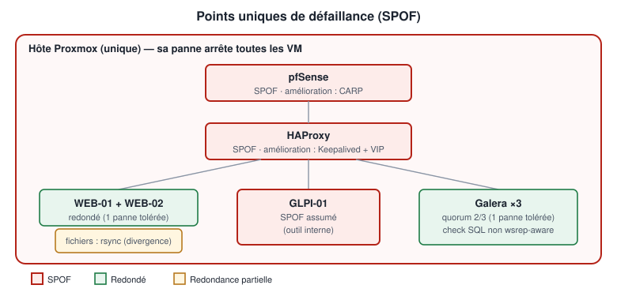

# Analyse des points uniques de défaillance (SPOF)

<p align="center"></p>

Un **SPOF** (*Single Point Of Failure*) est un composant unique dont la panne arrête tout ou partie du service. Les identifier est aussi important que de construire la redondance.

## Tableau de synthèse

| Composant | Nombre | Redondance | Impact panne | Amélioration |
|-----------|--------|------------|--------------|--------------|
| Hôte Proxmox | 1 | Aucune | **Total** : toutes les VM s'arrêtent | Cluster Proxmox 3 nœuds + stockage partagé (Ceph) ou réplication ZFS |
| pfSense | 1 | Aucune | **Total** : plus de routage inter-VLAN ni de NAT | 2 pfSense en CARP + pfsync |
| HAProxy | 1 | Aucune | **Total** : WordPress, GLPI et SQL indisponibles (même si serveurs et bases sont sains) | 2 HAProxy + Keepalived (VIP partagée) |
| WEB-01 / WEB-02 | 2 | Active / active | Aucun (capacité réduite de moitié) | 3e nœud si charge élevée |
| MYSQL-01/02/03 | 3 | Galera, quorum 2/3 | Aucun pour 1 nœud ; perte de 2 nœuds = arrêt du SQL | 5 nœuds pour tolérer 2 pannes ; health-check wsrep-aware |
| GLPI-01 | 1 | Aucune | GLPI indisponible ; WordPress non affecté | 2e serveur GLPI derrière HAProxy + sessions/fichiers partagés |
| Stockage WordPress (`wp-content/uploads`) | 2 copies | Synchro `rsync` manuelle/planifiée | Divergence : média absent sur un nœud (image cassée 1 fois sur 2) | NFS/GlusterFS, ou stockage objet (S3) |
| ADM-01 / Guacamole | 1 + 1 | Partielle | Aucun impact sur le service ; administration plus difficile | Console Proxmox en secours |
| Alimentation / réseau physique du labo | 1 | Aucune | Total | Hors périmètre |

## Analyse détaillée

### pfSense

Tout trafic inter-VLAN et tout accès externe passe par lui. Sa panne n'empêche pas HAProxy de joindre WEB-01/WEB-02 (même VLAN), mais coupe **HAProxy → Galera** (VLAN différents) : WordPress affiche alors « Erreur lors de la connexion à la base de données ».

**Amélioration** : deux pfSense en **CARP** (IP virtuelle sur chaque VLAN), synchronisation de configuration (XMLRPC) et d'états (pfsync).

### HAProxy

Point d'entrée **unique** de trois services. Sa panne rend l'infrastructure inaccessible alors que tous les backends sont sains : c'est le SPOF le plus paradoxal du projet.

**Amélioration** (roadmap) :

```text
             VIP 10.0.10.2 (Keepalived / VRRP)
              ┌────────────┴────────────┐
       HAPROXY-01 (MASTER)       HAPROXY-02 (BACKUP)
          10.0.10.5                  10.0.10.6
```

Les applications et le NAT gardent la même adresse ; la VIP bascule en ~1 à 3 s.

### GLPI

Un seul serveur applicatif. Choix assumé : GLPI est un outil interne dont une interruption courte est tolérable, contrairement au site public.

### Stockage WordPress

Galera ne réplique **que la base**. Un média téléversé sur WEB-02 n'existe que sur WEB-02 jusqu'à la prochaine synchronisation. Mesure en place : téléversements et mises à jour effectués sur WEB-01 uniquement, puis `rsync` vers WEB-02 ([synchronization.md](../05-wordpress/synchronization.md)).

### Hôte Proxmox

Toute la redondance est **logique**. Une panne matérielle de l'hôte arrête les 10 VM. C'est la limite fondamentale d'un lab mono-hôte, à mentionner explicitement devant un jury.

## Priorisation des améliorations

| Priorité | Amélioration | Effort | Gain |
|----------|--------------|--------|------|
| 1 | HAProxy secondaire + Keepalived | Moyen | Supprime le SPOF le plus critique côté service |
| 2 | Health-check Galera wsrep-aware | Faible | Évite d'envoyer du SQL vers un nœud Donor/Desynced |
| 3 | Stockage partagé WordPress | Moyen | Supprime la divergence de fichiers |
| 4 | pfSense CARP | Élevé | Supprime le SPOF réseau |
| 5 | Cluster Proxmox | Élevé (matériel) | Redondance physique |
