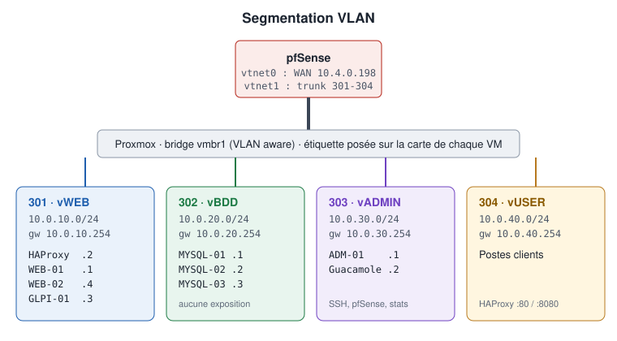

# Conception des VLAN

## Découpage

| VLAN | Nom | Contenu | Niveau de confiance | Exposition |
|------|-----|---------|---------------------|------------|
| 301 | vWEB | HAProxy, WEB-01, WEB-02, GLPI-01 | Moyen (zone « DMZ ») | HAProxy publié via NAT |
| 302 | vBDD | MYSQL-01, MYSQL-02, MYSQL-03 | Élevé (données) | Aucune |
| 303 | vADMIN | ADM-01, Guacamole | Élevé (privilèges) | Aucune |
| 304 | vUSER | Postes utilisateurs | Faible | — |

## Justification

### Pourquoi séparer web et bases de données ?

Un serveur web est exposé : il exécute du code (PHP, extensions WordPress) potentiellement vulnérable. S'il est compromis, l'attaquant ne doit pas pouvoir **atteindre librement** les bases. En plaçant les bases dans un VLAN distinct, tout accès passe par pfSense, qui n'autorise que **HAProxy → 3306**.

### Pourquoi un VLAN d'administration ?

Les flux d'administration (SSH, interface pfSense, statistiques HAProxy) donnent un contrôle total. Ils ne doivent provenir que de machines dédiées et maîtrisées (ADM-01, Guacamole), jamais d'un poste utilisateur.

### Pourquoi un VLAN utilisateurs ?

Les postes clients sont le maillon le plus exposé (navigation, pièces jointes). Ils ne doivent accéder qu'aux **services publiés** (HAProxy :80 et :8080), pas aux serveurs eux-mêmes.

### Pourquoi les serveurs web et GLPI dans le même VLAN ?

Ce sont tous des serveurs applicatifs publiés **via HAProxy**, avec le même profil de flux (HTTP entrant depuis HAProxy, SQL sortant vers HAProxy). Le regroupement simplifie les règles. *Amélioration possible* : isoler GLPI (données internes sensibles) dans un VLAN dédié.

## Limite à connaître

À l'intérieur d'un même VLAN, le trafic **ne passe pas par pfSense** : WEB-01 peut joindre GLPI-01 directement. Pour filtrer ces flux, il faut un pare-feu local sur chaque VM (nftables) — voir [07-security/hardening.md](../07-security/hardening.md).

## Numérotation

Les identifiants 301 à 304 suivent la convention du lab (centaine 3 = projet, unité = zone). La passerelle de chaque VLAN est en `.254`, ce qui laisse les adresses basses aux serveurs.

Configuration : [02-pfsense/vlans.md](../02-pfsense/vlans.md)
