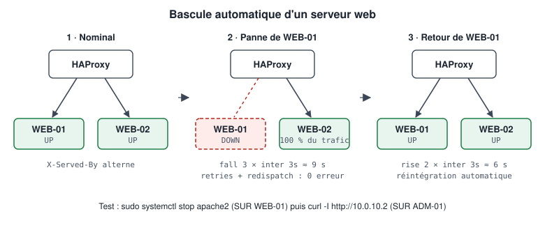

# WordPress — Failover

## Comportement attendu

| Événement | Détection | Effet client | Retour |
|-----------|-----------|--------------|--------|
| Apache arrêté sur WEB-01 | Health-check KO ×3 (~9 s) | Aucun : requêtes rejouées sur WEB-02 (`redispatch`) | `rise 2` (~6 s) après redémarrage |
| VM WEB-02 éteinte | Health-check KO ×3 (~9 s) | Aucun : tout est servi par WEB-01 | Idem |
| PHP cassé sur WEB-01 (erreur 500) | `/wp-login.php` renvoie 500 → KO | Aucun après détection | Idem |
| Base inaccessible depuis WEB-01 | `/wp-login.php` en erreur → KO | Dépend : si la base est inaccessible pour les deux, le site est en erreur | — |
| WEB-01 **et** WEB-02 arrêtés | Les deux DOWN | `503 Service Unavailable` | Dès qu'un serveur revient |

<p align="center"></p>

## Démonstration rapide

**SUR ADM-01** (terminal 1 — observation continue)

```bash
while true; do curl -s -o /dev/null -D - http://10.0.10.2 | grep -Ei '^HTTP/|x-served-by' | tr '\r\n' '  '; echo; sleep 1; done
```

**SUR WEB-01** (terminal 2)

```bash
sudo systemctl stop apache2
# observer : seules des réponses "X-Served-By: WEB-02"
sudo systemctl start apache2
# observer : l'alternance WEB-01 / WEB-02 reprend
```

## Procédure de test formelle

Procédure complète, dans les deux sens, avec critères de réussite : [08-tests/wordpress-failover.md](../08-tests/wordpress-failover.md)

Version scriptée :

```bash
# SUR ADM-01
./scripts/failover/test-web01-failure.sh --save
./scripts/failover/test-web02-failure.sh --save
```
